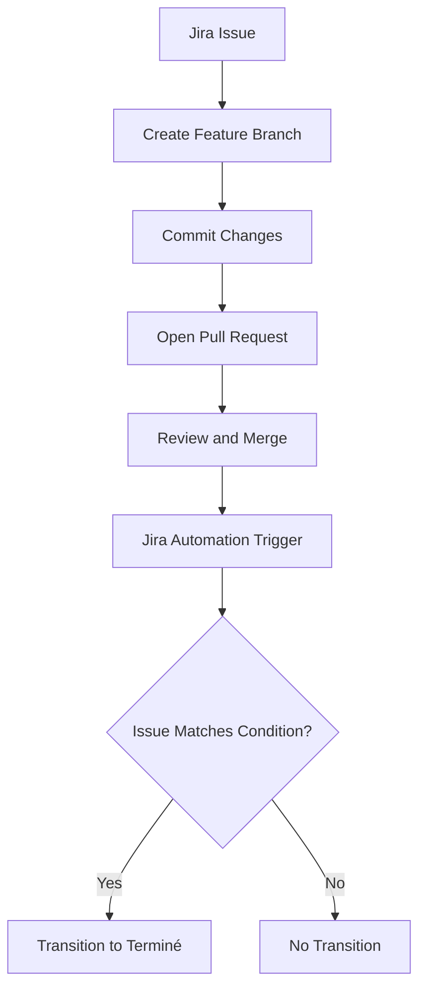

# Jira–GitHub Automation Lab

A hands-on project demonstrating how to integrate **Jira Cloud** with **GitHub** and automate Jira issue transitions when a pull request is merged.

The goal is to simulate a simple development-team workflow: track work in Jira, manage changes through Git branches and pull requests, review and merge changes, and verify the result through Jira Automation.

## Project Overview

This repository is a small proof of concept focused on development workflow integration rather than application development.

It demonstrates how GitHub pull request activity can be connected to Jira issues and used to trigger workflow automation.

### Objectives

- Connect Jira Cloud with a GitHub repository.
- Associate Git branches, commits, and pull requests with Jira issues.
- Follow a feature-branch workflow with pull requests targeting `main`.
- Configure a Jira Automation rule triggered by a merged pull request.
- Automatically transition the relevant Jira issue to `Terminé`.
- Validate automation execution using the Jira audit log.

## Technology Stack

| Technology | Purpose |
|---|---|
| Jira Cloud | Issue tracking and workflow management |
| Git | Version control |
| GitHub | Repository hosting, branches, commits, and pull requests |
| Jira Automation | Event-driven workflow automation |
| JQL | Jira Query Language for issue matching |
| Markdown | Project documentation |

## Workflow

The demonstrated workflow follows these steps:

1. Create or select a Jira issue.
2. Create a feature branch associated with the Jira issue key.
3. Make a change and commit it to the feature branch.
4. Open a pull request targeting `main`.
5. Review and merge the pull request.
6. Let Jira Automation process the merge event.
7. Verify the rule execution and resulting issue status in Jira.



## Automation Configuration

The rule tested in this repository is named:

`GitHub PR merged → JGAL-3 Done`

| Component | Configuration |
|---|---|
| Trigger | Pull request merged |
| Condition | `key = "JGAL-3"` |
| Action | Transition the issue to `Terminé` |
| Target issue | `JGAL-3` |

The rule is intentionally scoped to `JGAL-3` for this test. This configuration demonstrates the automation mechanism but does not yet represent a generic rule for every issue in the project.

## Validation Results

The integration was tested with a real GitHub pull request.

| Check | Result |
|---|---|
| Feature branch created | Passed |
| Commit created | Passed |
| Pull request opened | Passed |
| Pull request merged | Passed |
| Jira Automation execution | Successful |
| Execution time reported by Jira | 1.63 seconds |
| Jira issue status | `Terminé` |

**Test pull request:** [PR #2 — GitHub merge automation test](https://github.com/mndoumghar/jira-github-automation-lab/pull/2)

The Jira audit log recorded the automation execution with the status `Opération réussie`. The issue was displayed as `Terminé` after the test.

## Repository Structure

```text
jira-github-automation-lab/
├── README.md
├── connection-test.md
└── automation-test-jgal-3.txt
```

- `README.md` — Project documentation and test results.
- `connection-test.md` — Initial Jira–GitHub integration test associated with `JGAL-2`.
- `automation-test-jgal-3.txt` — Test file used for the `JGAL-3` automation workflow.

## How to Reproduce the Test

1. Make sure the GitHub repository is connected to Jira.
2. Confirm that the Jira Automation rule is active.
3. Use the `JGAL-3` test issue and ensure the rule condition matches it.
4. Create a feature branch containing the issue key, for example `feature/JGAL-3-test-automation`.
5. Commit a small test change and open a pull request targeting `main`.
6. Merge the pull request.
7. Open Jira and inspect the issue status.
8. Check the Automation audit log for the execution result.

The current rule uses the hard-coded condition `key = "JGAL-3"`. To test another issue, update the condition accordingly or redesign the rule to support the intended project-wide workflow.

## Lessons Learned

This project provides practical experience with:

- Git branching and commit conventions.
- Pull request review and merge workflows.
- Linking development activity to Jira issues.
- Jira Automation triggers, conditions, and actions.
- JQL-based issue matching.
- Reading audit logs to verify automated behavior and troubleshoot failures.

## Potential Improvements

- Generalize the automation to support relevant issues across the project.
- Add pull request review requirements before merging.
- Introduce automated tests and CI checks.
- Document the Jira workflow and permissions required for team collaboration.
- Expand test coverage to include unmatched issues and failed transitions.

## Project Status

**Status:** Core integration and the `JGAL-3` automation test completed successfully.

This repository is a learning lab and proof of concept, not a production application.
